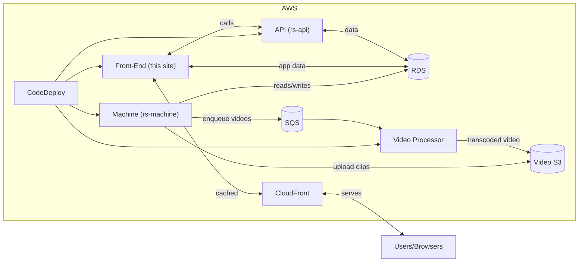

# Richmond Sunlight


This is the front-end of the website.  See also: [rs-machine](https://github.com/openva/rs-machine), the collection of scrapers and parsers that provide the site's third-party data, [rs-api](https://github.com/openva/rs-api), the API that powers (some of) the website, and [rs-video-processor](https://github.com/openva/rs-video-processor), the on-demand legislative-video-processing system.

## History

Richmond Sunlight started in 2005 as [a little RSS-based bill tracker](http://waldo.jaquith.org/bills/), updating every few hours. In 2006 it was built out as Richmond Sunlight, launching publicly in January of 2007. It's remained a hobby site ever since. The code base hasn’t been overhauled in all that time, and it shows — the site’s tech stack shows the growth rings of being developed over the course of many years. But it continues to function, and has been modernized in some ways, e.g. by adding a CI/CD pipeline, moving to SOA, etc.

## Branches

* [`master`](https://github.com/openva/richmondsunlight.com/tree/master): The [staging site](https://staging.richmondsunlight.com/).
* [`deploy`](https://github.com/openva/richmondsunlight.com/tree/deploy): The [production site](https://www.richmondsunlight.com/).

## Local development

The site can be run locally, in Docker:

1. [Install Docker](https://www.docker.com/products/docker-desktop).
1. Clone this repository. Make sure you’re using [the branch that you want](#branches).
1. Run `./docker-run.sh`.
1. In your browser, open `http://localhost:8000`.

Tests can be run with `./docker-tests.sh`.

### Local tests

There are additional tests, in `tests/local/`, that run against a larger sample of the database than is stored in GitHub. They load every bill, legislator, committee, and minutes page in the sample, failing on any page that doesn't load or that raises a PHP warning, and check every legislator's video clips, every video's captions, and every bill's fiscal impact statements.

1. Export the sample from the production database with `deploy/database_export.sh` (on the server, where its placeholders are filled in), which writes `deploy/mysql/local-test-records.sql`. It's a few hundred bills from the two most recent sessions, chosen to cover every type and status of bill, plus a dozen videos, so it's a few dozen megabytes. Copy it into `deploy/mysql/` here (it's ignored by Git).
1. [Rebuild the database](#rebuilding-the-database), which loads it.
1. Run `./docker-tests.sh --local`, or just the local tests, with `docker compose exec web /var/www/htdocs/includes/vendor/bin/phpunit --configuration /var/www/phpunit.xml --testsuite local`.

Without the sample, the local tests are skipped, except for those in `LocalDataTest`, which fail to say that it's missing. In Docker, PHP logs errors to `logs/php-errors.log`, rather than to Apache's log, which is how the tests find them.

When you are done, run `./docker-stop.sh` (or quit Docker).

### Rebuilding the database

The database is initialized from SQL dumps when the MariaDB container is first created. If you change any SQL files under `deploy/mysql/`, those changes won't take effect until you destroy the existing database volume and rebuild:

```sh
docker compose down && docker volume rm richmondsunlightcom_db_data
./docker-run.sh
```

Removing the `db_data` volume forces MariaDB to re-run the init scripts on the next startup.

## Architecture


